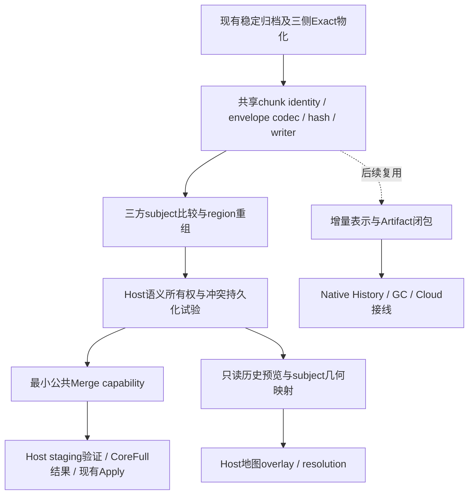
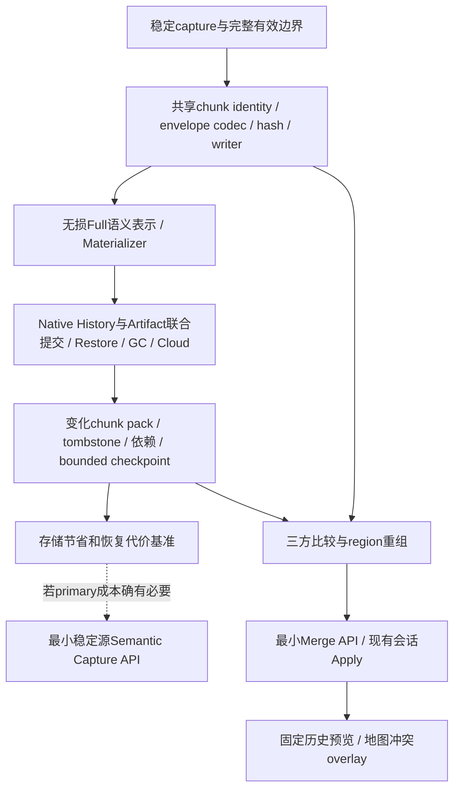
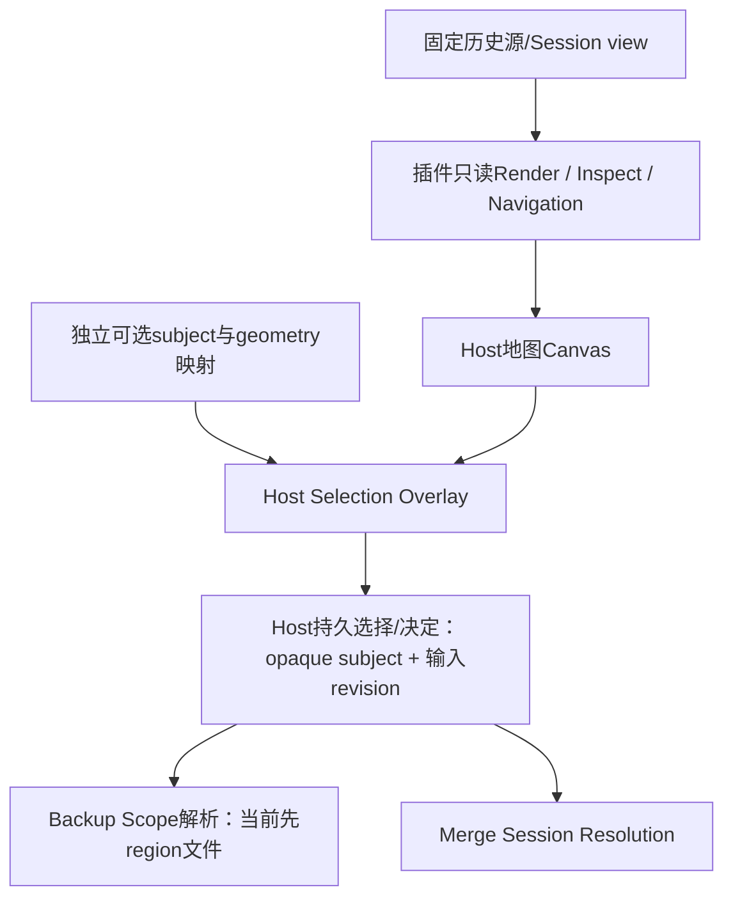

# FolderRewind / MineRewind：语义备份与语义合并架构决策

> 当前路线修订（2026-10-24）：Host实施基线为 `a09d80a`，MineRewind为 `00bc866`。P0/P1基础与P2闭环已完成；P2/P3已合入1.9.x并提供默认关闭的实验入口，原P3严格性能Gate没有全部通过。P4实现及非UI定向验证已完成，作为实验候选交付，记录见 [P4计划](../plans/Semantic_Merge_P4.md) 与 [独立Merge候选合同](../plugin-v3/semantic-merge-p4.md)。本节覆盖下方历史文字中的“入口关闭”等阶段状态，不覆盖历史验收结果。P4已具备真实加载、列表决定和安全Apply链路；人工UI验收、大世界性能压测和正式发布仍未完成。

## 当前阶段与依赖（2026-10-24）

| 阶段 | 当前状态与修订后的依赖 |
|---|---|
| P0/P1 | 基础验收已完成；共享reader/index/hash可复用，离线比较仍非可应用结果 |
| P2/P3 | 实验实现已集成；保持Exact与Host生命周期，性能专项、自动compaction和多设备云治理独立后置 |
| P4 | API 3.13候选、schema 3、独立文本消费者、MineRewind 1.9.18合成、覆盖证明和受阻单元、会话列表及CoreFull安全Apply已实现；精确版本验证见P4记录，人工及规模验收待执行 |
| P5a | 固定历史地图浏览已有代码，人工运行验收仍单独记录 |
| P5b | 地图冲突交互等待P4的稳定subject/会话决定；Preview保持只读，不再另建决定权威 |
| P6 | 稳定来源直接视图已在P3消除归档中转；通用Capture能力仍可选，不作为P4前提 |

P4准入要求是三侧固定Exact读取、覆盖证明、依赖保护与安全提交能力，不要求P3全部性能专项先完成。新的G4要求同文件多subject、受控新输出、实体单侧/双侧/跨维度安全、Base/Delete/Manual、重算/插件变化/恢复，以及不实现语义备份的独立文本插件通过。未通过保持开发入口；不以扩大冲突解释掉不正确的输出，也不绕过必要校验。P5b必须消费同一MergeSession的决定。

P4采用会话显式启用、默认保守策略，地形优先作为可选策略；生成region保留选中payload并确定性重建容器。细节与验收以P4计划为准。实施阶段不运行UI自动化，只做必要非UI验证并提供人工步骤。

MineRewind 1.9.18 修正现代根级空实体列表的布局误判。地形优先策略升级为 2：任一侧含真实内嵌实体的已识别现代区块及其 POI 固定保留目标，其余区块正常三方合并；列表和审阅明确提示不合入这些坐标的来源修改。旧 Level、未知布局和覆盖不足仍阻断。用户实际历史副本离线分析得到 2142 个区块项目（2093 自动、49 待选择），仅 (11, -20) 被固定；未在用户世界 Apply。保守策略仍为 1，公共 API 与未来文本插件独立接入能力不变。

覆盖准入修订：过滤边界定义读写权限，领域依赖定义语义组合所需完整性；不再因存在自定义黑名单就一律拒绝。Host 解释固定历史规则并证明路径族覆盖，插件声明全维度 Terrain/Entities/POI/mcc；不足或 Unknown 的世界保留为 blocked subject，其他世界仍可分析，但整次提交阻断。历史目录缺席的证明必须携带目标路径仍不存在的提交条件。当前过滤修改不能补回旧历史；复杂证明保守拒绝，不自动降级。公共查询不包含 Minecraft 类型，未来文本插件可独立接入。

输入存储格式与 Merge 能力分离：Core Full / Core Smart 的完整 Exact 历史也可使用 Minecraft 语义 Merge，已经用真实插件包验证；P3 并非前置条件。旧 Core 只有文件清单、缺少目录缺席证据时，有歧义的历史过滤仍可阻断；未来可独立补充 Core 捕获证据，但不推断或回填旧记录。

以下为2026-10-07历史调查与原路线，保留其当时基线及判断以供追溯；涉及当前实现和Gate时使用上方修订。

> P3 后继修订（2026-10-07）：下面的核验表保留原调查时点，不能作为当前实现状态。P1、P2 已完成；P3 开发接线见 [实施计划](../plans/Native_Artifact_Incremental_P3.md)、[验收状态](../plans/Native_Artifact_Incremental_P3_Acceptance.md) 和 [增量合同](../plugin-v3/incremental-artifact-p3.md)。日常路径改为 Smart 文件变化输入 → 指定语义基线 → 新 recipe/data packs → 完整逻辑目录 → 增量 Exact 验证 → 单语义主表示。Full 用于首次建立、边界/格式失效重建和自包含 checkpoint。按需读取、缓存交接、变化文件验证和 Cloud 缺失密文对象传输属于 P3 必需接线；不再把每次 Full 扫描视为过渡方案。P3 尚未通过完整准入 Gate，正常入口保持关闭。P4 Merge 仍独立于语义备份，文本 Provider 不必实现此表示。

> 核验日期：2026-10-07（Asia/Shanghai）。建议状态：供实施决策使用，未修改 accepted ADR 或产品代码。依据本地 HEAD、提交历史、当前源码与设计文档；未 fetch，不把本地 remote-tracking ref 当作远端实时状态。另只读查询了 NuGet 官方版本索引。本轮没有重新构建、运行测试或操作真实世界，文中既有测试记录不代表本轮认证。

**明确推荐 C：共享无损 chunk 模型 → 打通既有 Artifact 与 Native History → 最小 chunk 增量表示 → 最小语义 Merge Provider → 地图冲突交互；直接 semantic capture 仅在实测需要时追加。** 不先发布庞大的 Capture API，也不把当前文件级 Merge 接口直接搬进公共 Plugin API。

## 1. 当前代码状态核验

### 1.1 开发基线与已发布契约

| 项目 | 当前本地基线 | 真实版本及说明 |
|---|---|---|
| FolderRewind | `dev` / `5d8c8a6`；`1.9.x` / `dd29fe0`；均来自 2026-10-06 | App `1.9.6.0`；两个分支功能代码一致，`git diff 1.9.x HEAD` 只有 `notice_en/notice_zh`。开始核验时工作区干净 |
| MineRewind | `1.9.x` / `8ffb5cb`，2026-10-06 | 插件 `1.9.8`，要求 API `3.9`；开始核验时工作区干净 |
| Plugin API | `FolderRewind.Plugin.Abstractions` 当前源码 `3.9.0` | HostVersion 3.9，assembly identity 固定 `3.0.0.0`，BCL-only/net10.0；应用、插件、API独立版本 |
| NuGet 公共包 | 官方 flat-container 查询返回 `3.0.0`、`3.6.0` | 本轮未查询到 3.9.0。3.9 随当前 Host/内置插件使用，本地构建另产 `3.9.0-preview.b<hash>`；不能称 NuGet 3.9 已正式发布 |

版本证据：`FolderRewind/FolderRewind.csproj:7`、`FolderRewind.Plugin.Abstractions/FolderRewind.Plugin.Abstractions.csproj:7`、`FolderRewind.Plugin.Abstractions/PluginApi.cs:5`、`FolderRewind-Plugin-Minecraft/MineRewind/manifest.json:9`。官方查询：[NuGet versions](https://api.nuget.org/v3-flatcontainer/folderrewind.plugin.abstractions/index.json)。查询只证明该索引列出的包，不替代空缓存 restore，也不证明 GitHub Release 状态。

`docs/plugin-v3/README.md` 页首的 API 3.6/MineRewind 1.9.4 与插件 README 的 1.9.5 均落后于 HEAD。较新的 `docs/plugin-v3/spatial-preview-repair-2026-10-06.md` 与代码一致。历史设计必须按其对应提交理解。

**兼容性边界：** 已发布 3.0/3.6 中的能力、标识、enum 数值、构造器和行为不能因为主应用暂时未接通就任意重写。已有 Artifact、Scope、Consistency、Version Metadata 等都是需要维护的契约。3.9 的预览增量虽然未列在公共 NuGet，已经被当前 Host/内置插件消费，也应尽量兼容扩展。优先新增独立可选 capability、带默认值的属性或有默认实现的扩展；保留旧 positional constructors、旧调用语义；不把未知选项静默降级。真正破坏性变更按 API major 升级处理。`ContractTests.cs:129` 的 public API snapshot、`:145` 的已发布 capture enum 数值测试是实际约束，不能仅更新快照使测试通过。

### 1.2 能力核验表

| 能力 | 当前真实状态 | 源码依据 |
|---|---|---|
| Spatial Preview | 已有只读 Describe/Render/Inspect、导航、Close、渐进瓦片与合法坐标范围；不是待从零开发 | `Plugin.Abstractions/SpatialPreview.cs:4`；`Plugin.Runtime/Operations/SpatialPreviewDispatcher.cs` |
| MineRewind 地图 | 已有 2D 地表、占用远景、维度/玩家导航、错误状态、预算缓存 | `MineRewind/V3/WorldPreviewProvider.cs`、`WorldPreviewSession.Rendering.cs`、`MineRewind.World/SurfaceReader.cs` |
| Backup Scope | 已有显式区域坐标转换为文件 IncludePatterns；选择整 region 文件；玩家定位当前只属于预览导航 | `Plugin.Abstractions/Capabilities.cs:101`；`MineRewind/V3/MinecraftRegionBackupScope.cs:46` |
| Backup Consistency | 已有可释放 lease、稳定源标志、MineRewind 临时目录快照与失败策略 | `Capabilities.cs:112`；`MineRewind/V3/MinecraftSavesPlugin.cs:238`、`:249` |
| Version Metadata | 已有同一次稳定 capture 的只读视图、schema/version JSON；不是 chunk 数据库存储接口 | `Capabilities.cs:145`；`PluginV3BackupSession.cs:82` |
| Artifact 公共契约/Runtime | 已有 Transformer、Materializer、immutable DAG、staging、hash、graph revision、journal/GC | `Artifacts.cs:92`、`:120`、`:153`；`Plugin.Runtime/Artifacts/*` |
| Artifact → 当前 Native History | **未完成生产闭环，且显式阻断** | `NativeHistoryArtifactTransformPolicy.cs:9`；`PluginV3BackupSourceResolver.cs:166` |
| 通用 Branch/Merge | 已有 Source-owned branches、三方文件合并、会话、分页、批量决定、重算、审阅、安全 Apply/恢复 | `HistoryMergeService.cs`、`MergeSessionStore.cs`、`MergeOperationService.cs` |
| 公共 Plugin Merge API | **没有**；只有 Host 内部 `IHistoryMergeProvider` | `History/Merge/GenericFileMergeProvider.cs:70`；公共 `Manifest.cs:23` 无 Merge capability |
| MineRewind 语义 Merge | **没有**；`.mca`、NBT、stats/advancements 仍走普通文件规则 | 插件入口实现/注册、manifest、Host 默认 GenericFileMergeProvider 互证 |
| MineRewind 自定义 Artifact | **没有**；formats、transformers、restoreStrategies 均空 | `MineRewind/manifest.json:84`；入口不实现 Transformer/Materializer |
| Chunk-level incremental storage/capture | **没有**；当前不能仅因 3 个 chunk 变化而自然拆分 `.mca` | Scope 返回路径；现有 Anvil 是只读解析与预览 |

表内简称 `Plugin.Abstractions`/`Plugin.Runtime` 分别指根目录 `FolderRewind.Plugin.Abstractions`/`FolderRewind.Plugin.Runtime`；MineRewind 路径均在嵌套插件仓库。

普通文件三方合并不是“所有 `.mca` 一律冲突”：单侧修改或双方字节相同仍可自动选择；双方分别修改同一 `.mca` 的不同 chunk，当前仍是一个文件冲突。

### 1.3 历史背景为何会误导判断

- Plugin v3 用 capabilities 与 Host-owned execution 替代有顺序依赖的 hooks。ADR 0002/0005 已明确 Host 持有配置、事务、History、retention、Cloud、完整性和落盘权。
- 旧执行计划记录真实 MineDelta/reverse-delta 用例暴露 after-backup 修改旧 archive 的 chain poisoning、云端分歧等问题，由此引入 Artifact graph transaction/materializer。它证明语义表示有真实消费者，不证明官方 MineRewind 已经实现它。
- `e34dee4`（2026-08-28）在 Native History 重构中删除旧 `PluginV3ArtifactService`、Artifact Cloud/Restore 集成及 `ArtifactVerticalSliceTests`；`57885b2`（08-29）明确加入“与原生历史暂未集成”的阻断。旧 M4 全绿不能证明今天接通。
- `706ad48`（10-02）将 Checkpoint/Branch/Workspace 收窄到单 Source；不要沿用旧配置级 branch 方案。
- `625afe5`、`3e62516`、`b39c059`、`ada8e74`（10-03）完成 core archive 链重建/安全清理；其实现不自动覆盖 PluginArtifact。
- `310bfb8`、`1108615`、`8735430`、`4ada4e4`（10-04）完成 Merge 应用级任务、双栏比较/批量决策、结果审阅/安全恢复和页面接线。
- Host `c37e447`、`fd2ed80`、`cc6a522`；MineRewind `c8f7391`、`9740fd7`、`8ffb5cb`（10-05/06）完成 World 模型、只读预览及 API 3.9 修复。地表不是合并相等依据。

## 2. 真正缺失的基础能力

不是再造 Backup/History/Preview，而是以下五个边界。

1. **可用于恢复的 chunk 模型与 writer。** 现有 `ChunkKey/RegionKey/DimensionDescriptor/ChunkReadState` 已有；`ChunkRecord(State,Nbt)` 丢失 container 保真信息，缺持久 index/hash、删除语义、无损 writer、完整 terrain/entities/poi 清单。
2. **Native History 与 Artifact 的联合生命周期。** 主应用 `NativeHistoryApplicationService.cs:415` 只注册 core archive/smart handlers；`IPluginArtifactBackend` 没有产品实现。需要把 staged capture、Artifact ledger、Version Representation、Commit Pack、local replicas、恢复/锁定、GC/Cloud 接成闭环，不能只删 `MustBlock`。
3. **语义 subject 与物理文件所有权的分离。** 一个 provider 必须独占某组物理输出路径，却能在其内部枚举多个 chunk subjects；现有 path-based conflicts 做不到。
4. **固定历史源的只读地图与 subject→geometry 映射。** 当前 preview 只开 live Config/Folder；generation 不是 capture snapshot。历史 base/ours/theirs 必须绑定会话固定输入。
5. **可选、后置的直接 semantic capture。** Transformer 已能承担“表示转换”的契约；若要不生成完整 primary archive、降低每次读取/压缩成本，才需要 Host稳定源→插件capture 的新 seam。

三个问题必须分别验收：

| 问题 | 输入/输出 | 边界 |
|---|---|---|
| Backup Scope | 区域选择→路径白名单 | 一个 `.mca` 入选仍按整文件捕获；当前 `.mcc` 还保守覆盖所选维度全部外置文件 |
| Chunk incremental representation | 完整逻辑状态→索引、变化payload、依赖与删除标记 | 可以不重复持久存储整个 `.mca`；不等于避免 Core 全量读取/临时归档 |
| Chunk merge | base/ours/theirs 同一subject的值→结果或冲突 | 需要重组region，但不要求先有增量存储格式 |

一次只选部分 chunk 的备份还涉及“未选择≠删除”、semantic coverage 和受控 read-modify-write restore；当前文件边界模型不能自然表达。**首版语义增量仍覆盖完整有效 Source Boundary，不把 chunk 子集备份一起塞进去。**

## 3. 两条路线的依赖关系图

### A：Merge First 的真实依赖



### B：Semantic Backup First 的真实依赖



实线表示必需工作或本路线选择的先后；B 图中增量表示能提供索引和可靠读写验证，但**Merge 算法并不逻辑依赖增量链**。A 的 codec 可以反向复用到 B；前提是它处理完整 payload/组件/保真，而不是只有地表diff。两路线共享模型，但存储闭包与交互会话各有独立成本。

## 4. Merge First 深入分析

优势：最早解决“两人在同一 region 不同 chunk 建造却冲突”；输入可继续使用现有 CoreFull/Smart 归档的 Exact materialization，输出先落 CoreFull，因此不必先接通 Plugin Artifact Cloud/GC。现有会话、replan、staging、safe apply 的价值可直接复用。

实际工作并非“注册一个 provider”。`IHistoryMergeProvider.Analyze` 同步读取全量文件manifest并返回全量冲突；`HistoryMergeService.cs:189` 校验每个授权路径恰被认领，automatic values 必须来自三侧原文件，冲突路径不能重叠。同一 `.mca` 中两个 conflict 或新合成文件都不符合当前契约。`MergeResolutionChoice` 只有 Ours/Theirs/Manual，没有独立 Base/Delete。

最小可行流程应为：固定三侧视图→provider 申明互斥物理domain→分页subject分析→Host持久化决定→provider向受限staging写新region→Host验证完整树/归档/round-trip→现有Apply。文件级未认领域继续 generic merge；不能让多个provider各自重写同一`.mca`。

API 冻结风险在于：真实 chunk payload ownership、`.mcc`伴随输出、component bundle、删除、插件版本变化、异步分页、取消、replan失效、historical map都尚无生产样本。现在有足够场景做**实验slice**，没有足够证据一次冻结长期公共Merge API。将现有内部接口原样公开会锁住完整文件manifest和一次性数组。

如果用户把协作合并列为压倒性优先级，A可以成立；但仍必须先做共享codec/writer，不能先写地图操作再补数据安全。对本轮同时关心存储效率和长期架构的目标，A先公开API带来的返工风险更大。

## 5. Semantic Backup First 深入分析

优势：真实恢复验证迫使设计尽早覆盖无损payload、外置文件、缺失组件、损坏、稳定源、依赖、插件失效，比仅展示diff更容易发现遗漏。经过验证的chunk index/lookup/materializer会显著减少后续Merge的数据准备与重组成本。

代价：写错误影响日常每次备份和长期可恢复性，覆盖面比主动触发Merge大；必须处理 Native History集成缺口、双层依赖、Cloud、retention、格式升级，而不是只写delta codec。直接先设计CustomCapture API更危险，会把单一插件需求扩成一套备份引擎协议。

建议将 B 拆成两种交付：

- **B1：chunk 增量存储表示。** Core先捕获稳定primary；Transformer产生索引与变化pack。变更3chunk通常只新增3个payload和必要container/索引元数据。primary仍临时产生，只有验证、commit、可恢复性及baseline依赖交接成功后才可安全释放。若primary永远保留，不能声称节省了持久存储。
- **B2：chunk 增量直接捕获。** Host稳定source view让插件生成表示，避免先创建整份primary。这才可能降低归档读/写/压缩开销，但仍可能需要扫描全部region header或读取payload做可靠hash；不能承诺“只读取3chunk”，mtime/timestamp只是提示。

B1已经能回答用户“不重新存整个.mca”的持久存储目标，无需先发布B2。第一版本只支持 Complete Full primary 与同Source/同边界/同format的anchor，其他mode拒绝或保留primary+明确warning；不同时处理Smart primary链转换与reverse-delta。

### 5.1 V1→V4 的恢复、删除、压缩和云端

```text
SourceVersion V4 --逻辑父版本--> V3             （内容历史）
       |
       +--> Representation R4 --artifactRoot--> A4 （恢复表示）
                                                 |
                                            A3 -> A2 -> A1
                                                （payload依赖）
```

这不是另建一套 Minecraft History：插件清单可记录chunk→pack位置及tombstone；**跨Artifact依赖必须全部显式交给Host**。不允许私有路径或插件DataStore藏着唯一本体。

| 问题 | 应有行为与当前缺口 |
|---|---|
| Restore V4 | Host求完整DAG闭包、验证格式/owner/hash、拓扑传入Materializer；按基准和delta重建全部有效文件并验证结果；Host Safe Restore才修改目标 |
| 删除V1/V2 | 释放历史展示或materialization保留资格，不等于删除A1/A2；只要A4可达就必须保留。如果依赖缺失/损坏，V4阻断且明确诊断 |
| Retention reachability | 保留Version/Representation、pin、Safety Snapshot、未完成Merge/事务等roots→representation closure→plugin roots→artifact closure；首版允许空间暂不能回收，禁止假成功删除 |
| Compact | 生成新的immutable full/checkpoint Artifact，并为同一V4增加新Representation；验证后Host切换选择/保留事实，最后GC旧闭包，不改V4内容祖先，不改旧payload |
| 现有Core链重建 | 可复用规划/事务原则；`HistoryChainRewritePlanner.cs:137`仅支持CoreFull/Rolling/SmartDelta，不能声称已支持PluginArtifact压缩 |
| Cloud | 上传缺失的整个闭包及格式/索引元数据、逐对象hash；dependency先就绪，最后发布可恢复replica/root manifest；同步历史事实与声明物理副本可恢复必须区分。下载也补齐闭包，重试可幂等 |
| 当前Cloud | `CloudSyncService.Replicas.cs:42`走单文件归档；`:148`的manifest `ArtifactRootId=null`，optional字段不等于闭包支持。需实际接线 |
| 完整性 | 同时验证pack字节、索引offset/长度、DAG完整性、chunk状态/hash、materialized树与来源指纹；哈希一致仅证明保存的字节一致，不能替代正确capture验证 |
| 插件禁用/卸载 | 保留逻辑历史和payload，恢复显示依赖缺失并fail closed；可用的等价CoreFull作为回退；提供显式导出/物化再卸载路径，不能自动当成普通zip或删owned artifact |

当前已有 `HistoryRetentionPlanner.cs:404` 收集Plugin roots、`NativeHistoryApplicationService.cs:617` 调用ledger GC，这是可复用接点；缺口是完整生产链路及所有root生命周期覆盖，不是从零写图。

## 6. 是否存在更合理的 Hybrid

存在，推荐的是**表示先行、Capture后置、Merge输出先Full**的有界路线：

1. MineRewind内部共享模型先做无损读写和hash，不动公共API。
2. 用已有Transformer/Materializer做最小full表示vertical slice，补Host接线；首轮保留core副本作对照与回退。
3. 在同一格式内增加bounded forward delta和checkpoint；只有验证空间可安全回收才宣传增量存储收益。
4. 在同一chunk模型上做Merge；先用冲突列表与CoreFull输出证明正确，再冻结最小公共capability。
5. 地图只作为既有持久决定的另一个交互视图；最后按实测评估直接Capture。

它不是A+B同时启动：Phase 1不设计公共selection框架；Phase 2不做增量算法；Phase 3不做Merge UI；Phase 4不要求增量merge输出；Phase 5不改backup pipeline；Phase 6可永久不做。每阶段都有可独立停下来的成果与退出条件。复用的是codec/index/materializer和Host安全链路，不是提前搭一个无消费者的统一语义平台。

## 7. Spatial Preview / Selection / Conflict UI 的职责边界

**选择方案2：保持 `ISpatialPreviewCapability` 纯只读。**



插件负责坐标系、维度到opaque layer的映射、subject identity与几何查询、领域诊断；Host负责鼠标/键盘/无障碍、选框、撤销、批量动作、状态持久化、执行与事务。Core只见provider ID、model version、subject ID、layer、bounds，不见ChunkPos/NBT/DimensionRegistry等Minecraft类型。

坐标不等于subject，格线尺寸也不等于稳定identity。映射可能返回零/多个subject，应带输入view token和模型版本，量大时分页。先在实际Merge adapter内部验证映射，第二个真实消费者出现或必须跨边界时再抽最小公共契约，不先造通用UI framework。

当前`SpatialPreviewSource(Config,Folder,Generation)`只描述live源；不能通过伪造Folder.Path把会话临时目录冒充用户配置。需要**独立、只读、Host签发的历史view入口**，经lease控制materialized workspace/read handles；可作为新optional preview-source扩展，而不是给旧Preview加backup/apply回调。

冲突地图以固定base/ours/theirs为数据源，tint/outline标记冲突与决策；所有ours/theirs/base/delete动作调用同一个Host MergeSession。删掉chunk后背景仍应可展示base或ours以供定位。地图失败可退回列表，不应阻断已有合法决定的审阅。刷新live地图不得改变Merge输入或偷偷使旧决定继续有效。

初期地图选区可输出现有region scope，但UI必须明确会扩大到整个32×32 chunk region，并预览实际文件范围。真正chunk子集backup另立coverage/restore Gate。

## 8. 自定义 Backup API 应采用什么模型

| 模型 | 优点 | 关键问题 | 决策 |
|---|---|---|---|
| Before/Core/After hooks | 接入表面简单 | 隐式顺序、不可追踪副作用、after失败与core成功矛盾、修改已提交archive破坏不可变性；与v3方向冲突 | 不采用；consistency和只读observer已有明确职责 |
| Custom Capture Provider | 可避免多余primary归档 | 稳定性、完整覆盖、删除、基线、payload边界、失败回退都成为公共协议；现阶段冻结风险最大 | 后置、受真实性能证据驱动 |
| Artifact Transformer | 公共API/Runtime已有，Host控制staging与DAG；便于core对照 | 当前Native接线缺失；减少存储而非primary capture成本；candidate读权限/规模有限 | **近期主模型** |
| Host稳定source + Semantic Capture | 生命周期清楚，capture性能潜力最好 | 要Host可靠稳定view/inventory、显式coverage与受限artifact writer；不能只用live path | **若需要直接capture，采用此受控Hybrid模型** |

建议生命周期：

```text
Host operation gate + recovery preflight
→ resolve scope/policy + acquire consistency/stable-view lease
→ Core capture（近期）或受控semantic capture（后期）
→ plugin transform/capture写Host staging，返回声明式结果
→ Host seal + verify closure + materialize/compare + durable pending intent
→ publish immutable artifacts + Native History Commit Pack/replica binding
→ retain/Cloud queue/completion，失败按durable事实分类
```

Artifact ledger与History pack不应假装是一次磁盘原子写。需要一个Host journal/state machine：提交前登记pending roots防GC；payload封存但History未提交时只可恢复或回收孤儿；pack持久化后取消/清理失败只成为post-commit warning/recovery-required，不把已提交事实回滚成失败。重启用同transaction identity幂等完成。

| 维度 | 必需约束 |
|---|---|
| 原子性/crash | 结果直到Host验证并绑定Representation后才对用户宣称成功；journal保护中间roots，重试不重复版本/branch update |
| cancellation/progress | capability lease携带取消，按读取/编码/物化阶段报告有界进度；取消后禁止发布未验证结果，commit后按事实处理 |
| integrity | Host重算hash/size/path与闭包；插件metadata不能自证正确；恢复round-trip独立核验 |
| encryption | Host受控解密输入并加密封存输出，插件仅获逻辑read/write handles、不获密码；分别校验logical/storage hash，Cloud只复制存储密文。当前Artifact逻辑目录存储不等于已接通Native加密envelope；未完成时阻断加密配置的语义策略 |
| History/Branch | Host创建SourceVersion、Checkpoint、BranchUpdate；representation替换不改逻辑父图；one-shot scope不能扩大managed boundary |
| retention/Cloud | 只消费Host确认的root与完整闭包；pending intent/Merge sessions/安全快照保持保护；无隐式外部依赖 |
| restore/checkout/merge | Materializer只写isolated workspace；现有Host transaction应用目标。Coordinator仍只围绕live mutation；ordinary player preservation不得泄漏到Checkout/Merge |
| 插件disable/uninstall | lease/draining保障一致性，缺provider明确不可恢复；不静默换格式、不误删数据；设置与格式升级分别验证 |
| API/versioning | format schema/hash policy/provider implementation分别标识；兼容读取旧format，升级写新表示；无法支持的contract fail closed |

已有接口可承担：Transformer输出、Materializer写workspace、Scope路径过滤、Consistency lease、Version Metadata小型说明。真正可能新增的是稳定capture inventory/read view、受限内容发射与completion/coverage，以及受控candidate closure访问，不是一个任意字符串的Backup Mode。

当前 `ArtifactTransformCoordinator` 只向transformer暴露primary和列出的compatible roots，不自动给全部依赖handles；与restore的拓扑闭包不同。多层delta读取需在真实slice中补齐受限closure access，优先内部接线或可选request扩展，不能假定当前接口自然能遍历任何历史。

## 9. Chunk Semantic Model 是否应该成为共同基础

**应该共享，但不应把整个Minecraft模型放进FolderRewind Core。** 它是MineRewind的持久领域codec/index，加上只读preview projection和merge/backup两个消费者。

| 模型组成 | 备份用途 | 合并用途 |
|---|---|---|
| Source/世界身份 + canonical dimension ID + chunk X/Z | 跨版本寻址，避免同坐标跨世界碰撞 | 对齐三侧同一subject；物理路径变化与世界身份变化分开 |
| Region X/Z、slot、component kind | pack/index和region重建 | 物理所有权与写回归组；负坐标用已有floor div/mod |
| Present/Absent/Deleted与未知/损坏状态 | tombstone与完整覆盖 | add/add、modify/delete；未知/损坏绝不能当不存在 |
| 完整opaque payload与hash | 去重/增量引用 | 相等判断与整chunk选择 |
| 原始compression、external flag/.mcc、timestamp | 无损存储及文件恢复 | 取侧payload、伴随文件和确定性输出 |
| region layout/residual/header | 对现有Exact逐字节还原 | 输入验证；merge结果可建立自己的确定布局 |
| bounds/limits/diagnostics/version | 拒绝爆量/损坏，不丢数据 | 不支持subject阻断或整文件保守回退 |
| writer/materializer | 还原全部region文件 | 从选中chunk生成有效region与必要.mcc |

建议 identity 内部形态为 `(Source identity, world-relative identity, dimension id, chunkX, chunkZ, component)`，Region是派生定位信息，不把文件绝对路径当持久identity。若允许一Source包含多world，必须保留world-relative discriminator并检测重名/歧义。公开给Host的仍是opaque subject ID。

**至少区分两类hash：** 原始payload/pack/container的完整性hash；用于比较的payload内容hash。首版比较可基于解压后的完整NBT字节加domain/schema/version前缀，不做NBT字段排序或忽略“看似无关”字段，允许保守的假冲突。compression/timestamp/layout另保留作恢复证据。NBT语义canonicalization后置，不能把256列地表颜色或height hash当完整chunk hash。

首版最小opaque单位是合理的；更安全的选择单元为同坐标 `Terrain + Entities + Poi` bundle，各component仍分别记录存在/缺失与hash，但先不让三者独立取不同分支。当前enum存在不代表scanner已覆盖它们。bundle也不能独自解决跨chunk关联：Base实体E在A，Ours把E移到B，Theirs把E移到C；逐chunk比较会把A的一致删除、B/C的各自新增全判为自动合并，产生重复实体。首版必须检测重复身份/迁移关联并升级为更大组冲突或阻断；若不做身份检测，两侧都改entities的domain应保守整体选侧，关联范围不明时扩大到维度或Source，并连带必要terrain/poi。只发warning不足以通过Merge安全Gate。这是身份安全检查，不要求entity字段级合并。全局level.dat/data/player仍采用保守文件冲突，跨chunk结构/模组依赖需明确支持边界；不声称opaque chunk merge能证明任意mod世界语义一致。

**Exact是首要Gate。** 合法MCA重写会改变sector布局、压缩输出、时间戳、padding、未引用残留数据；仅NBT round-trip不能代表同一个文件状态。当前Merge固定树按文件字节hash（`GenericFileMergeProvider.cs:19`、`:27`），依赖Exact物化。建议首版byte-preserving chunk/envelope slices + container residual；未知或不可无损解析的文件保留完整opaque原文件。对修改3chunk的例子，新增大小应约为变更payload+索引/container差异，但重排/大量残留变化时不能承诺固定3chunk大小。

如果要改为仅游戏语义等价，必须单独定义fidelity与identity合同并重新审计restore/checkout/baseline/merge；本路线不把这项大变更当捷径。Merge创建的是一个**新Version**，可对其新生成的确定文件树建立Exact；Backup为既有Version增加表示则必须证明同一逻辑状态的既有保真契约。

结论：先完成共同模型及可恢复表示，能降低Merge codec/读取/重组成本，但不会消除Merge Session/UI/所有权工作；反向先做Merge也能复用codec，不过若只解析terrain、丢原始bytes，它并不能自然变成可靠增量备份。

## 10. 架构与工程对比表

统一采用 **1–5分，5最好**。对“工作量/复杂度/侵入/风险/技术债”等维度，5代表更少或更低；不是风险越高分越高。比较相同长期目标下的路线策略，非工时估算；Hybrid不声称总功能量更少，优势是分阶段降低锁定风险。

| 维度 | Merge First | Semantic Backup First（合理的表示先行版本） | 推荐Hybrid |
|---|---|---|---|
| 用户短期收益 | **4**：可先消除同region不同chunk伪冲突；对只备份用户收益有限 | **3**：存储潜力大，但安全闭环交付慢 | **3**：先可靠性/存储切片，地图交互后置 |
| 对现有架构侵入 | **3**：复用Apply，但需改path conflict约束 | **4**：先接既有表示；若另加直接capture则下降 | **4**：先已有表示seam，历史核心语义保持 |
| Plugin API复杂度 | **2**：subject/ownership/resolve/paging/output齐来 | **4**：Transformer可复用；直接capture后置才能保持此分 | **4**：先既有API，真实切片决定最小加法 |
| API冻结风险 | **2**：缺真实持久chunk消费者就公开Merge | **3**：表示安全可验证，但未必提前验证Merge ownership | **4**：两种消费者验证后再冻结，风险仍存在 |
| History Core风险 | **3**：修改session/provenance与新结果 | **3**：表示联合提交及长期依赖需补齐 | **4**：先full对照、分阶段收窄故障域，不能免除同类风险 |
| Backup Core风险 | **5**：最初完全沿用core capture | **4**：同样可保留core primary；提前直接capture则明显更差 | **4**：初期保留primary对照，后续才优化 |
| 可复用基础设施 | **3**：codec可复用，缺storage closure验证 | **4**：恢复/index充分，Merge交互另做 | **5**：codec、materializer、Host生命周期逐步共用 |
| MineRewind工作量 | **2**：parser/writer之外立即做Merge与地图 | **2**：codec/delta/索引/策略/兼容集中 | **3**：总量未消失，阶段单一、返工更少 |
| FolderRewind工作量 | **3**：先改Merge契约与路由 | **3**：补Artifact闭环，capture可不做 | **3**：仍需补接线，但推迟不必要API |
| UI工作量 | **2**：很快需要历史地图/决策交互 | **4**：初期以表示状态/诊断为主 | **4**：先复用列表，地图只加同一决定投影 |
| 数据迁移成本 | **4**：旧归档可物化解析，结果先CoreFull | **4**：旧归档可以不迁移；新format仍需长期decoder | **4**：旧历史不转换，新表示渐进加入 |
| 测试复杂度 | **2**：三侧组合/删除/replan/UI/崩溃矩阵 | **2**：chain/GC/Cloud/恢复矩阵；直接capture再增加一层 | **3**：复杂度总量仍在，但每Gate隔离故障域 |
| 出错后的数据安全风险 | **3**：危险集中于显式Apply，有Safety Snapshot | **3**：有core对照可控制，但错误影响日常备份长期可恢复性 | **4**：分阶段启用与双用途模型先验；若B同样设Gate风险可相同 |
| 其他插件通用性 | **3**：容易把chunk坐标塞入API | **4**：既有artifact/Host原则本就通用 | **4**：opaque subject/pack/Host事务，并以第二种测试格式验证 |
| 是否容易形成技术债 | **2**：文件模型硬塞chunk易留永久适配 | **3**：若备份格式不预验Merge，后续subject模型可能调整 | **4**：不公开未验证抽象，推迟性能层与高级语义 |

合理的Backup First若同样拆为Transformer表示先行、Capture后置，它与本报告Hybrid前半段高度趋同；评分差距不是本质定律。推荐C的具体增量是P1就用离线三方用例反向检验共同模型、P4先CoreFull输出、UI最后组合，不把完整capture优化当Merge前置。若B也采用这些边界，它实质上就是同一推荐顺序。反之先发庞大Capture API的B，会显著恶化API/Backup风险与工作量。

## 11. 主要风险与容易走错的设计

1. **把有接口当已上线。** 当前Artifact被阻断，fake Runtime测试不等于Native生产闭环；启用前必须接完restore/GC/Cloud和crash recovery。
2. **把partial当删除。** 未选择、读取失败、unsupported、changing均不同于Absent；这是Scope/Delta/Merge共通的最危险歧义。
3. **一个chunk一个Host Artifact。** `ArtifactLedgerValidator.cs:8` 当前最大4096节点、深度256；默认transform上限100000 files/16GiB。应采用有界pack+内部索引；长期多版本仍可能超过4096，需要在限制前checkpoint/compaction或显式停止，不能只调大常量称可扩展。
4. **无限delta链与隐藏CAS。** 达到深度上限前生成checkpoint；所有被引用pack在Host DAG可见，逻辑父图不是物理依赖图。
5. **让hash替代一致性。** preview generation和mtime重查不是原子快照。MineRewind consistency Prefer可回退live；语义路径必须验证稳定视图质量，必要时退回普通备份带warning或阻断，而非默默生成可信delta。
6. **破坏Exact。** 只存parse后的NBT/地表，丢compression/布局；或把合法世界等同于byte-exact恢复。
7. **过早canonicalization。** 忽略实体/POI/tick字段会错误合并；首版opaque比较允许保守冲突。
8. **会话分页≠分析流式。** SQLite已有500条分页/UI100条，但当前Analyze/三侧manifest全量；大世界内存需单独验收，preview缓存预算不是进程上限。
9. **把plugin disable当格式无主。** materializer消失不能删除数据；upgrade不得让旧格式不可读；准备结果必须绑定provider/schema/policy与输入签名。
10. **把数据安全说成“已有Safe Restore自然兜底”。** Snapshot必须本身可Exact恢复且被保留，pending roots不能被GC；验证失败应发生在live mutation之前。
11. **一次开发逆向delta、chunk子集backup、语义Merge、地图编辑、直接Capture。** 它们共享模型不意味着必须同时交付。

## 12. 最终推荐路线

**推荐 C，而不是纯A或先新建Capture API的B。**

决定依据是当前代码的两个事实：公共Artifact契约已有、Native接线却缺失；Merge安全编排成熟、领域输入输出契约仍严格文件化。最划算的投入是先让共同chunk模型与现有表示体系真正工作，以恢复和依赖生命周期验证模型，然后公开最小Merge API。

近期最重要的产品交付不是“Minecraft Backup Mode”，而是“可验证恢复、受Host管理的chunk增量表示”。随后语义Merge先产CoreFull，把变更范围限制在subject分析和受控materialization。地图是最终交互增量，直接Capture是性能增量；二者都不应倒逼基础模型仓促冻结。

## 13. 分阶段实施顺序

| 阶段 | 唯一主要交付 | 明确不捎带 |
|---|---|---|
| P0 基线与验收合同 | 固定Host/Plugin/API/package SHA、纠正当前能力说明；确定Exact、支持格式、完整source与一致性策略；真实世界样本和测量基线 | 不升级public API，不改历史图 |
| P1 共享无损chunk内核 | 扩展MineRewind.World的完整index、raw envelope/payload、hash policy、component bundle、reader/writer；离线三方比较证明模型可复用 | 不做公共Merge/Capture/Selection框架；不发布backup格式 |
| P2 Full语义表示闭环 | 现有Transformer+Materializer真实插件slice；Native History绑定、受限closure读取及生存期lease、restore/checkout、GC/Cloud、Host加密envelope、插件缺失和journal；保留Core对照 | 不做delta、不开新capture入口、不删阻断了事 |
| P3 Chunk增量存储 | same-format forward delta、tombstone、pack/index、bounded checkpoint、原primary安全交接/释放；验证真实存储收益 | 不承诺减少primary I/O；不做reverse chain或跨source CAS |
| P4 最小语义Merge | 固定三侧、互斥domain、分页subject、Ours/Theirs/Base/Delete、重算/恢复；列表验收；结果先CoreFull；经过slice后冻结最小可选capability | 不同时输出增量merge表示、不做NBT字段合并 |
| P5 只读历史地图与冲突交互 | Host overlay+独立subject mapping；相同MergeSession决定的地图视图；可选区域文件scope选择 | 不向Preview加入mutation；不把region选择称chunk子集备份 |
| P6 条件性直接Capture | 仅当P3实测瓶颈在primary读写/压缩时，Host稳定source→受限semantic capture→同一artifact commit；经实验再公开 | 不做万能Backup Mode/Hook；若收益不足则停在P5 |

P1可先复用旧归档做离线比较；这是模型验证，不是在公共产品同时开展两条完整路线。P2闭环未成熟时，P1可独立保留，现有文件备份和预览继续使用。

## 14. 每阶段 Decision Gate

| Gate | 可验证进入条件 | 不通过如何处理 |
|---|---|---|
| G0→P1 | 本地SHA/包版本固定；byte-exact与semantic equality分开；Java支持矩阵、异常策略、source coverage、真实样本和资源预算书面确定 | 停留核验，不根据过时文档启动API设计 |
| G1→P2 | 多维度/负坐标/terrain-entities-poi/`.mcc`/gzip-zlib-raw/缺失与损坏分类；原文件逐字节round-trip；未知格式完整保留或明确阻断；旧preview不回归 | 继续codec/writer；不写生产语义备份 |
| G2→P3 | 真实插件经Runtime激活完成Full capture→Representation→重启→restore/checkout；core对照一致；提交各切点故障注入、取消/disable；Cloud闭包、roots/GC、旧format读取、加密输入/输出及密文Cloud验证，密码不传插件；缺失加密桥时加密配置必须明确阻断 | 保留实验格式/core副本；不对外启用delta、不删除transform阻断 |
| G3→P4 | 1024chunk中3变化不重复保存整个region主体；删除/新增/外置转换正确；V4恢复及V1/V2释放不破链；cap/深度/空间回收受控；真实大型世界峰值内存/还原耗时/空间收益合格 | 继续full或bounded checkpoint；保留多余依赖而非冒险GC；不宣称增量收益 |
| G4→P5 | 用户示例自动合并正确；同chunk不同值冲突；base/delete、bundle一致、损坏fail closed；跨chunk实体迁移/重复身份有检测及升级冲突或保守整体选侧策略，不能仅warning；replan签名失效、provider缺失/升级、crash resume；安全快照与Apply fault injection；一个小型非Minecraft测试provider证明Core无Minecraft类型 | 继续列表+内部试验，不冻结公共API或启动地图决策功能 |
| G5完成 | 地图绑定固定历史view；overlay与列表决定一致、刷新/关闭/重开/取消不串状态；分页/批量/键盘/无障碍可用；Preview契约仍只读 | 保留列表为正式入口，地图仅浏览 |
| G6准入与完成 | P3基准证明primary成本是主要瓶颈且可省；稳定inventory/lease契约可成立；同数据下capture与core恢复字节一致，crash/retention/Cloud所有G2/G3重验；收益足以抵偿API维护 | 不新增Capture API，持续用Transformer；不是路线失败 |

资源Gate不得只写“性能合理”：P0固定至少小样本、真实多维大型世界和异常语料三档，记录源/备份字节、chunk数量、冷暖盘、峰值live memory、读取/写入/压缩量、backup p50/p95、restore p95、最长链深。**建议起始工程目标而非已测成绩**：后台chunk处理预算先设256MiB并单列Host/codec开销；10倍chunk规模不允许工作缓存线性10倍增长；受控I/O取消在1秒内观察到，单次不可取消OS调用单列；delta链先保守设不超过16次再checkpoint；新格式不得突破Runtime限额，越界应预检诊断。预算最终按P0硬件与真实样本校准，在G3前不可临时放宽掩盖回归。checkpoint并不自动消除被保留旧版本的节点数，需同时验证4096节点累计上限。

## 15. 预计涉及的 FolderRewind / MineRewind 代码区域

以下是拟修改区域，不是本轮修改清单。无需重写所有模块。

| 区域/现有类型 | Merge First | Backup First | 推荐Hybrid首次介入 |
|---|---|---|---|
| `FolderRewind.Plugin.Abstractions`：`Artifacts.cs`、`Capabilities.cs`、`Manifest.cs`、`PluginApi.cs`、`PublicApi.txt` | 新可选semantic merge descriptors/request/output；不要原样公开内部provider | 保留Transformer/Materializer，必要时optional closure/capture合同 | P2优先无public变更；P4最小Merge；P6才Capture |
| `FolderRewind.Plugin.Runtime.Activation`：`PluginManifestContractValidator`、capability注册/lease | 增Merge静态声明、路由、输出冻结 | 校验format/strategy与capture声明，draining | P2既有Artifact；P4Merge |
| `FolderRewind.Plugin.Runtime.Artifacts`：`ArtifactTransformCoordinator`、`RestoreMaterializationCoordinator`、`FileArtifactLedgerStore`、`ArtifactLedgerValidator`、`BoundedArtifactStorage` | 初期可不碰 | closure读权限、joint commit、pack规模、hash和GC | P2接线，P3限额与delta |
| `FolderRewind.Services.Plugins.V3`：`PluginV3BackupSourceResolver`、`NativeHistoryArtifactTransformPolicy`、`PluginV3BackupSession`、`PluginV3CaptureLeaseOwner` | 保留现有backup路径 | 新表示准入、稳定capture、失败策略 | P2闭环通过后才有条件解除阻断；P6稳定源扩展 |
| `FolderRewind.Services.BackupService*`、`History.Capture`：`SourceCaptureResult`、`VerifiedArchiveCaptureFactory`、baseline cache | 主要用于Safety Snapshot，避免重写 | primary/semantic candidate封存、表示绑定、基线交接 | P2/P3；不要以Version Metadata储存payload |
| `History.Representation`：`PluginArtifactRepresentationHandler`、`IPluginArtifactBackend`、`RepresentationRuntime`；`NativeHistoryApplicationService.cs` | 输入先Exact物化；语义索引读取是后续优化 | 实现真实backend并注册；深验与闭包lease | P2核心修改 |
| `History.Retention`：`HistoryRetentionPlanner/Executor`、`HistoryChainRewritePlanner/Executor`、`HistoryCleanupCoordinator` | 保护semantic session输入/输出 | plugin roots、不可达GC、安全compact；现有Core限制不可直接取消 | P2正确保护，P3有界压缩/回收 |
| `History.Cloud`、`Services/CloudSyncService.Replicas.cs` | 先复用CoreFull输出 | 闭包上传/下载、manifest与root可见性、重试/孤儿 | P2完成基础闭环，P3验证delta |
| `History.Merge`：`GenericFileMergeProvider`；`History.Application/HistoryMergeService/Planner/CommitBuilder/ApplyService` | subject/domain adapter、分页分析、受控materialized output | 先保证Exact输入接口可用 | P4保留generic fallback与CoreFull builder |
| `History.LocalState/MergeSessionStore*`、`HistoryRestoreTransactionJournal` | semantic subject/schema/choice、签名与replan、crash恢复 | 保护roots以避免backup GC破坏会话 | P2审计root，P4扩语义会话 |
| `Services/MergeOperationService*`、`NativeHistoryApplicationService.Merge*`、`ViewModels/MergePageViewModel*`、`Views/MergePage*` | 立即增加语义决定与列表/地图衔接 | 暂不动UI | P4列表、P5地图 |
| `SpatialPreviewViewModel`、`SpatialPreviewCanvas`、`SpatialPreviewViewport`、`PluginV3SpatialPreview`、`SpatialPreviewDispatcher` | 历史view/overlay/subject映射 | 可仅region scope选择 | P5；保持现有readonly Render/Inspect |
| MineRewind `MineRewind.World/WorldModel.cs`、`AnvilReader.cs`、`WorldScanner.cs`、新增lossless writer/index/pack codec | 完整三侧chunk数据与重组 | full/delta/materializer共用内核 | P1共同基础，避免挤入`SurfaceReader` |
| MineRewind `V3/MinecraftSavesPlugin*.cs`、`MinecraftSnapshotCopier`、`MinecraftRegionBackupScope`、manifest/settings | 新Merge capability注册与策略 | 新Transformer/Materializer/格式声明；稳定源/完整scope | P2/P3；P4Merge；P6capture |
| MineRewind `WorldPreviewProvider`、`WorldPreviewSession.Rendering`、`PreviewBudgetCache` | 固定historical source渲染与geometry | preview index可共享不可作数据authority | P5；不把冲突决定塞进插件cache |
| 现有Host/Runtime/Plugin测试工程 | merge/session/apply/API兼容矩阵 | artifact/capture/restore/retention/cloud矩阵 | 各Gate增加独立oracle/真实fixture/故障注入，避免只测mock |

## 16. 哪些功能明确推迟到以后

- block/entity/NBT字段级自动合并与NBT canonicalization。
- Bedrock LevelDB语义备份/合并；当前Bedrock继续普通文件策略。
- 直接semantic capture公共API，直到P3性能实证足够。
- 真正chunk子集备份/局部恢复；必须另解决semantic coverage和read-modify-write边界。
- reverse delta、跨世界/跨Config CAS、全局去重服务、任意第三方pipeline takeover。
- Merge结果直接写delta表示；初期CoreFull即可。
- 自动大规模转换已有历史；旧Core表示继续可用，新增表示可渐进创建。
- 为假设插件设计复杂通用空间UI框架；先实际subject映射消费者。
- 高级3D、block纹理/资源包、mod渲染、洞穴自动模式；与这次架构决策无必需依赖。

---

## 附录 A：Host 关键证据定位

以下定位绑定本报告开头HEAD；后续行号随源码变化，以类/方法名复核。

| 证据 | 文件定位 |
|---|---|
| transform强制阻断 | `FolderRewind/Services/Plugins/V3/NativeHistoryArtifactTransformPolicy.cs:7`；`PluginV3BackupSourceResolver.cs:166` |
| 生产Runtime仅core handlers | `FolderRewind/Services/NativeHistoryApplicationService.cs:415` |
| plugin backend seam、binding | `FolderRewind/History/Representation/RepresentationBackends.cs:37`；`PluginArtifactRepresentationHandler.cs:11`、`:108` |
| 已有transform/materialize公共契约 | `FolderRewind.Plugin.Abstractions/Artifacts.cs:92`、`:100`、`:120`、`:153` |
| transform读范围和staging提交 | `FolderRewind.Plugin.Runtime/Artifacts/ArtifactOperationCoordinators.cs:74`、`:136` |
| restore完整拓扑closure | 同文件 `:308`、`:313`、`:335` |
| artifact有界DAG | `ArtifactLedgerValidator.cs:8`、`:59`；同目录`FileArtifactLedgerStore.cs:172`、`:258`、`:300` |
| Native roots到Artifact GC | `FolderRewind/History/Retention/HistoryRetentionPlanner.cs:404`；`NativeHistoryApplicationService.cs:617` |
| core-only chain rewrite | `FolderRewind/History/Retention/HistoryChainRewritePlanner.cs:137` |
| Cloud当前单payload/null artifact root | `FolderRewind/Services/CloudSyncService.Replicas.cs:42`、`:148` |
| 文件内部provider及三方规则 | `FolderRewind/History/Merge/GenericFileMergeProvider.cs:60`、`:70`、`:82` |
| 不能多个subject共claim同文件 | `FolderRewind/History/Application/HistoryMergeService.cs:189` |
| 当前resolution选项和持久会话 | `FolderRewind/History/LocalState/MergeSessionStore.cs:17`、`:18`、`:236`、`:256`、`:308`、`:403` |
| Exact物化与新CoreFull输出 | `HistoryMergeService.cs:70`；`HistoryMergeCommitBuilder.cs:147`、`:164`、`:175` |
| Preview live/source generation | `FolderRewind.Plugin.Abstractions/SpatialPreview.cs:16`；`FolderRewind/Services/Plugins/V3/PluginV3SpatialPreview.cs:20` |
| Scope/Consistency/Metadata边界 | `FolderRewind.Plugin.Abstractions/Capabilities.cs:101`、`:112`、`:145` |

主要设计文档：[ADR 0002](../adr/0002-plugin-v3-capability-boundary-and-identities.md)、[ADR 0005](../adr/0005-plugin-artifacts-use-host-owned-graph-transactions.md)、[ADR 0006](../adr/0006-history-graph-foundation.md)、[ADR 0007](../adr/0007-source-owned-history-branches.md)、[当前预览修复](../plugin-v3/spatial-preview-repair-2026-10-06.md)、[Merge工作页现状](../plans/Branch_Merge_Workspace_Refactor_2026-10-04.md)。[旧Plugin v3执行计划](../plans/FolderRewind_Plugin_System_v3_Execution_Plan.md)仅在与对应提交核对后用作历史背景，不作为当前生产闭环的替代证据。

## 附录 B：MineRewind 逐项源码证据

## MineRewind 当前基线

- 本地仓库 `D:/Programs/FolderRewind/FolderRewind-Plugin-Minecraft` 当前分支 `1.9.x`，工作区干净，HEAD / 本地 `origin/1.9.x` 均为 `8ffb5cb85d143f35c1d3f7a6eb0d42cc473a4398`（2026-10-06，`fix(preview): 世界预览优化`）。未 fetch，因此远程跟踪引用只是本机已知状态，不能据此宣称 GitHub 最新状态。
- `MineRewind/manifest.json:9` 与 `MineRewind/MineRewind.csproj:10` 都是 **1.9.8**；manifest `:17` 要求 Plugin API major 3 / minor 9；csproj `:14` 引用 `FolderRewind.Plugin.Abstractions 3.9.0`。
- README `:5` 仍描述 1.9.5 / API 3.6，是落后的版本说明。`docs/plugin-v3/spatial-preview-repair-2026-10-06.md:28` 明确当前 API 候选未发布 NuGet，构建脚本生成 `3.9.0-preview.b<hash>` 并使用独立本地 feed/cache。因此不能把当前源码 3.9 当作已发布 NuGet 契约，也不能把 README 的 3.6 当作 HEAD。
- 本地 tags 最高见 `v1.9.5`；本地 `master` 落后 `origin/master`，两者均不代表当前开发基线。本结论不声称远程 Release 全量核验。

## 近期实现与历史背景

| 提交 | 日期 | 核验意义 |
|---|---|---|
| `8ffb5cb` | 2026-10-06 | 渐进预览、统一预算缓存、异常隔离、Anvil index 复用，版本 1.9.8 / API 3.9 |
| `a4a0578` | 2026-10-05 | 1.9.7 版本对齐 |
| `e0ff509` | 2026-10-05 | 保存的玩家位置与维度导航 |
| `d5506ba` | 2026-10-05 | 版本化颜色、地形和水体呈现 |
| `2994a89` | 2026-10-05 | 预览会话生命周期与通用导航契约 |
| `9740fd7` | 2026-10-05 | 只读 spatialPreview capability / 按需地表瓦片 |
| `c8f7391` | 2026-10-05 | 新建无 UI 依赖 World 模型与现代区块地表读取 |
| `dc0beb8`, `96f665d` | 2026-10-04 | 快照遍历避开内部文件系统链接、保留配置源布局 |
| `eea38e8` | 2026-09-18 | 玩家保留移入 Host staging，避免 continuation 后改写 live world |
| `e50f5bc` | 2026-09-07 | 配置级 Restore / Checkout / Merge 协调与恢复结果契约 |
| `baf5571` | 2026-08-31 | 不可变版本 metadata snapshot |
| `7c57299` | 2026-08-31 | 快速还原按活动分支语义选目标 |
| `97e60f7` | 2026-08-16 | 移除 v2 实现，当前走 v3 |

与历史设计交叉：`docs/plans/FolderRewind_1.9.0_Branch_Merge_Implementation_Plan.md:32` 当时明确排除 region parser、chunk merge 与 2D 预览；`:40` 提出先 2D 再领域 merge；`:232` 首发只注册通用 provider，`:233` 明确延迟冻结公共插件 merge API。如今 parser/2D 已落地，后两个 merge 边界仍适用。不可继续把 2D/region reader 列为“从零开始”。

## 已有能力与不存在的能力

`MineRewind/V3/MinecraftSavesPlugin.cs:9` 列出真正实现的接口：`ISpatialPreviewCapability`、`IBackupConsistencyCapability`、`IFilePolicyCapability`、`IBackupScopeCapability`、`IFolderMetadataCapability`、`IVersionMetadataProviderCapability`、`IRestoreCoordinatorCapability`、`IRestoreStagingPreparationCapability` 及 discovery/reconciliation/commands 等。

`MineRewind/manifest.json:69` 对齐 capability 清单；`:84–86` 的 `artifactFormats`、`artifactTransformers`、`restoreStrategies` 都是空数组。入口接口列表、全仓实现检索、manifest 与 README `:25–28` 一致：**无 Minecraft 专用 Merge Provider，也没有使用自定义 Artifact Transformer / Representation / Restore Materializer**。玩家 NBT staging preparation 不是 semantic artifact materializer。

README `:27–28` 明确 `.mca`、玩家 NBT、stats、advancements 双方修改按文件冲突处理；当前新增只读预览并未改变此路由。最终文件冲突行为仍应由 Host 的当前 Generic Merge provider 再交叉核验。

## Backup Scope 事实

- `MinecraftSavesPlugin.Capabilities.cs:140` 的 `ResolveAsync` 返回 `BackupScopeResult` 的路径规则，`:177` 输出 patterns，不输出 chunk payload、delta 或 artifact。
- `MinecraftRegionBackupScope.cs:46` 对选中 region 生成 `region/r.x.z.mca`、`entities/r.x.z.mca`、`poi/r.x.z.mca`，`:53–55` 保守纳入所选维度所有 `c.*.*.mcc`；`:16` EssentialRules 保留 level.dat、玩家、stats 等。
- `:291` 把方块坐标除 512 后 floor 成 region；`:116` 区域边界转换为整 region 范围。边界为 32 KiB / 128 行 / 每维度 4096 region。Scope 目前只允许三种原版维度（`:302`），预览 scanner 却已能发现 namespace 自定义维度；两者尚非共享完整领域索引。
- 因而“选中一个 chunk”在当前 scope 内只能扩大成整个 region 文件，无法表达 `.mca` 中只存 3 个变化 chunk。即便进一步精确筛选 external `.mcc` 文件也仍是路径过滤，不能替代 `.mca` 内部增量表示。
- `.mcc` 全通配是当前实现的保守策略，不是 Minecraft 格式不可求 region：其文件名已有全局 chunk 坐标。未来可用共享索引求其 owning region，但不能只按孤立 `.mcc` 文件列表处理，要检查 `.mca` external marker 的关联。

## Consistency 与 Version Metadata 事实

- `MinecraftSavesPlugin.cs:158` Acquire：活动世界尝试 KnotLink handshake、WORLD_SAVED；Require 不满足时阻断；Prefer 记录警告继续。
- `:238` `MinecraftSnapshotCopier.Copy(sourceRoot, snapshotPath, ...)` 复制整个配置 source 到临时目录；`:246` 返回这个 snapshot lease。copy `MinecraftSnapshotCopier.cs:62` 用 `File.Copy`，不是 chunk capture。
- `MinecraftSavesPlugin.cs:249` Prefer 下复制失败可退回 live source；`:679` `IsStableSourceView` 仅以 temporaryPath 非空表示复制产物稳定。这证明 artifact capture 可消费既有 lease，但不能把“复制完成后目录静止”理解成“复制期间整世界达到原子游戏时刻”；语义表示需区分 stable source view 与 capture consistency/协调质量。
- `MinecraftSavesPlugin.Capabilities.cs:237` Version Metadata 从 Host `request.Source.OpenReadAsync` 读取 level.dat，`:255` 保存 dataVersion/levelName/gameType/lastPlayed，`:264` schema `minecraft.world`, v1。它是有限描述 metadata，不是 chunk manifest、payload store 或 dependency graph。
- `MinecraftSavesPlugin.cs:271` `PrepareAsync` 在 Host current / target source views 上生成玩家保留 proposals，不在操作后改写 Host 已提交 archive。这是应继续沿用的受控阶段设计。

## 当前 World 模型可复用的基础

- `MineRewind.World/WorldModel.cs:5` `RegionKey(X,Z)`、`:6` `ChunkKey(X,Z)`，Region 由 floor division / Slot 由 floor modulo，已处理负坐标。
- `:23` 已声明 `ChunkComponentKind { Terrain, Entities, Poi }`；`:24` 已区分 Present/Absent/Corrupt/UnsupportedVersion/UnsupportedCompression/Changing/Unavailable。错误不能降格为 absent/deleted。
- `:25–26` WorldDescriptor / DimensionDescriptor 有 dimension namespace ID、路径与 terrain region→file index。
- `WorldScanner.cs:18` 覆盖 legacy、Paper siblings 与 `dimensions/<namespace>/...`；`:51` 同 ID 多路径歧义时报错；`:55` 实际只索引 `region/r.*.*.mca`。声明三种 component 不等于实现其语义索引；scanner 尚未构建 entities/poi 的完整同坐标 bundle。
- `WorldModel.cs:35` WorldPaths 拒绝越出 configured source 和任何 reparse point，不能为了 merge/materialize 绕过。

## Anvil / NBT 支持的准确边界

- `AnvilReader.cs:35` 明确是只读 envelope reader，不 normalize/write；`:6` `ChunkRecord` 只存 `State, byte[]? Nbt`，没有 payload hash、timestamp、compression/external/layout 保存字段。
- `:9` AnvilRegionIndex 持有完整 8 KiB header、长度、mtime、extent validity；`:15–30` 验证 header pointers/sector overlap。timestamp table 在 raw header 中存在，但未建模为 chunk metadata。
- `:74–75` 仅 compression 1=gzip、2=zlib、3=raw；4/LZ4 为 UnsupportedCompression。`:80–85` 支持 external marker 和 `c.<chunkX>.<chunkZ>.mcc`；`:38` 16 MiB decode limit。
- `:101` 比较读取前后 region length/mtime/header 与 external length/mtime，最多两次，再 Changing；这是预览防撕裂的尽力措施，不是稳定 capture 事务保证。
- `SurfaceReader.cs:9` 只支持列出的 release DataVersion（注释 1.18–26.1.2），`:24` NBT 限深 64、tags 100000、array length 1048576；`:33` 校验 xPos/zPos；`:105` 结果只有 256 列地表投影。
- 因此 opaque 备份读取不能硬复用 SurfaceReader 的版本白名单和投影；只需保守 envelope/payload 处理即可支持未知但可原样保留的 payload，预览不支持不等于备份必须丢弃。
- 当前没有 production Anvil writer、round-trip 保真测试、persisted chunk index、content hash、semantic delta、tombstone 或 chunk materializer。测试 fixture 的 WriteRegion 不是可复用 production writer。

## Spatial Preview 已完成与限制

- `MinecraftSavesPlugin.Preview.cs:7–30` 通过 Describe/Render/Inspect/GetNavigationTargets/Close 提供只读 capability。
- `WorldPreviewProvider.cs:8` 明确缓存地表是可丢弃预览数据，**never backup or merge authority**。
- `:23` 按 dimension 生成 layer，CellSize=16、major grid=512、可选扫描高度、通用坐标范围；`:40` 保存玩家/出生点导航；`:56` Inspect 返回 dimension/block/chunk/region/dataVersion/表面详情。
- `WorldPreviewSession.Rendering.cs:67,79` 每轮最多 64 个 region/chunk 与 50ms 软时间预算；`:143` IsFinal 渐进返回；`:173` >=16 units/pixel 只用 header occupancy/已有 surface summary，不主动完整解码远景。session 生命周期禁止 late Render 重新打开已关闭缓存（WorldPreviewProvider.cs:167）。
- `docs/plugin-v3/spatial-preview-repair-2026-10-06.md:9` 128 MiB provider / 64 MiB Host 缓存不包含世界目录索引、inflight/平台资源/全进程工作集。`:34` 记录 93 项 MineRewind 测试通过；`:40` 合成 1024 chunk 测试有预算/暖缓存证据，末段明确**真实大世界 p95/长期内存仍未验证**。
- 地图目前只读当前配置 source，不是历史 artifact 的可寻址只读版本视图；未来 base/ours/theirs 地图应由 Host materialization/read-only session 提供稳定 source，不能直接对 live source 切换三方身份。

## 架构推论与建议（不是已实现事实）

1. 两项能力应共享 Minecraft 内部 model / codec / index / materializer；不必先完成一套生产 semantic backup API，才能设计 merge。先共享 codec + 精確保真 materialization 的 vertical slice，避免抢先冻结两套 API。
2. 建议 identity 包含 Host Source 所属的 world identity / canonical dimension ID / chunk X,Z / component kind；region 坐标是派生 storage address。首版保守 merge unit 可取同坐标 terrain/entities/poi bundle，避免各自自动选择后拼出跨时间组合；日后有实证再放开 component 独立策略。
3. 存储 hash 与合并 equality hash 分离：原始 envelope/compressed bytes hash 用于完整性/精确还原；解压后完整 opaque NBT bytes hash 用于减少重压缩造成的假差异。首版不做 NBT field normalize，因此 tag 序列变化可保守视为变化。compression/timestamp/sector placement 不应悄悄混进或丢出 equality，必须显式定义。
4. `Exact` fidelity 需遵循 Host 当前定义。若是字节精确，恢复合法 region 不等于恢复原字节；需要保存 timestamp table、header/layout/padding/trailer 和未知损坏数据的 residual，或采用能重建原字节的 region recipe。不能仅存解压 NBT 后重新压缩便宣称 Exact。若放宽为 semantic exact，则必须正式设计新的 fidelity/checkout guard，而非偷换既有 Exact。
5. 错误 chunk 不能当 tombstone；unsupported/malformed 数据应整 region opaque fallback 或阻断优化，保留既有 raw backup 恢复性。merge 需保守 whole-region conflict/unsupported 提示，不能只合并“能解析的那些 chunk”。
6. 先证明插件内部 reader→index→writer round-trip，再做 Host 管理的 post-capture transformer + materializer 试点。该试点可降低存储和 Cloud bytes，却不自动降低整个 source copy/CoreFull capture I/O；先测量，再决定是否增加直接消费 stable source 的 capture seam。
7. 真正减少存储可采用 immutable complete index + content-addressed payload packs：index 直接引用实际需要的 pack artifacts，把 chunk 指针细节留在插件格式；Host 只看明确依赖闭包。避免每 chunk 一个 Host artifact/History fact，避免把 semantic parent 当 storage parent。
8. 不需要把所有 predecessor V1→V2→V3 串行依赖进 Minecraft 私链。完整 index 可引用存活 payload packs；如选择 delta manifest，也必须通过 Host artifact dependencies 宣告全部依赖。Compact 生成新 representation/artifacts，保留同一 Source Version 身份；不得改旧 artifact。
9. 预览维持 read-only，Host overlay 管选择及 resolution。provider 按 ID/坐标映射 generic selection 到自身 semantic subjects；Core 不出现 Minecraft dimension/chunk 类型。Selection 的 render 坐标不是稳定 subject identity，重新 plan 必须重新验证 source generation/content hash。
10. 优先推迟 block/entity/NBT field merge、未知压缩可编辑支持、自动世界修复、持久地图平台、开放任意 before/after hook。真实 Java 世界 load/reopen 与 corruption/retention/cloud fault injection 应是从实验转生产的 gate。

## MineRewind 预计修改区域

| 路线 | 现有可复用区域 | 真正新增职责 |
|---|---|---|
| Merge First | WorldModel / AnvilReader / WorldScanner；V3 Preview；restore coordination | 保真 region writer、三方索引/equality、bundle ownership、冲突分页/稳定 ID、prepared merge output；artifact 格式先继续 CoreFull |
| Backup First | ConsistencyLease / SnapshotCopier、World 项目、manifest capability 注册 | semantic representation codec、immutable index+packs、transform/materialize adapter、依赖声明、失败 opaque fallback；不能以 VersionMetadata 代 payload |
| 收敛 Hybrid | 先重用并扩充 World 独立层；既有预览不重做 | 内部 model/round-trip→实验表示/闭包验证→按需 stable-source capture→merge adapter→Host conflict overlay；公共契约在真实 slice 后发布 |

所有代码行号均针对上述 MineRewind HEAD；Host 文档行号针对本轮读取的本地文件。正式结论需要主代理合并 Host History/Artifact/Runtime 当前实现证据。
